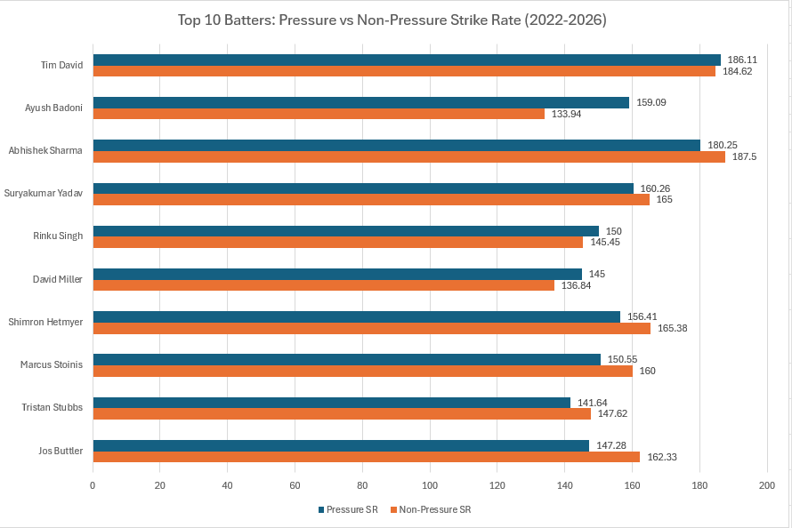
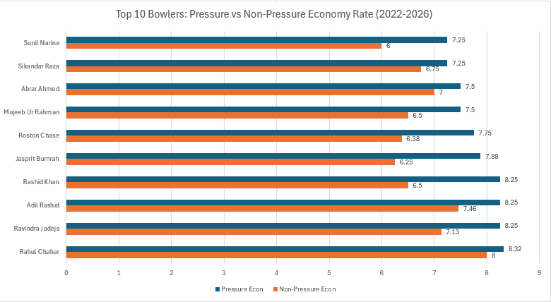

# T20 Clutch Performance & Pressure Analytics Engine

*Identifying the most reliable T20 batters and bowlers under pressure. IPL and Full-Member T20I data, 2022 to 2026. Built for SupeRR Selector Season 2, Round 1.*

## Summary

Most "clutch player" rankings are circular: a match is called a pressure match only when the player did well in it. This project defines pressure from **match context and teammate scoring only**, never from the target player's own output. It then compares each player's pressure performance with their own ordinary baseline and with their peers, and ranks them with a Clutch Index.

**Headline result:** under pressure the league's median batting strike rate falls from **142.11 to 125.93**, and the median bowling economy rises from **8.00 to 9.67 RPO**. Only **14 batters** and **87 bowlers** passed every filter, and the top 10 in each list come from those pools.

## Key findings

"Pressure" is defined in the Method section. Batters and bowlers are scored differently on purpose.

### 1. The pressure tags separate hard situations from ordinary play

**Batting (6,314 qualified innings)**

| Situation | Innings | Share | Median strike rate | Median dot-ball % |
|---|---|---|---|---|
| Ordinary | 5,195 | 82.3% | 142.11 | 33.33% |
| Pressure | 1,119 | 17.7% | 125.93 | 40.63% |

**Bowling (7,920 qualified spells)**

| Situation | Spells | Share | Median economy | Median dot-ball % | Avg wickets per spell |
|---|---|---|---|---|---|
| Ordinary | 4,892 | 61.8% | 8.00 | 37.50% | 1.19 |
| Pressure | 3,028 | 38.2% | 9.67 | 33.33% | 0.98 |

- Batters score about 11.4% slower and face about 7 percentage points more dot balls under pressure.
- Bowlers concede 1.67 more runs per over, take fewer dot balls and take fewer wickets per spell.
- The tags pick out harder situations, but the thresholds are judgment calls (see Limitations).

### 2. Top 10 batters under pressure

Ranked by Batting Clutch Index (higher is better, above 1.00 means better than the median qualified batter).

| Rank | Batter | Pressure innings | Median pressure SR | Median non-pressure SR | SR dip | Dot-ball % shift | Clutch Index |
|---|---|---|---|---|---|---|---|
| 1 | Tim David | 10 | 186.11 | 184.62 | -0.81% | +3.13% | 1.130 |
| 2 | Ayush Badoni | 9 | 159.09 | 133.94 | -18.78% | -1.67% | 1.129 |
| 3 | Abhishek Sharma | 8 | 180.25 | 187.50 | +3.87% | -4.79% | 1.087 |
| 4 | Suryakumar Yadav | 8 | 160.26 | 165.00 | +2.87% | -1.12% | 1.025 |
| 5 | Rinku Singh | 11 | 150.00 | 145.45 | -3.13% | +0.30% | 1.020 |
| 6 | David Miller | 8 | 145.00 | 136.84 | -5.96% | +5.50% | 1.018 |
| 7 | Shimron Hetmyer | 13 | 156.41 | 165.38 | +5.42% | +8.75% | 0.999 |
| 8 | Marcus Stoinis | 8 | 150.55 | 160.00 | +5.91% | +6.79% | 0.977 |
| 9 | Tristan Stubbs | 10 | 141.64 | 147.62 | +4.05% | +9.43% | 0.956 |
| 10 | Jos Buttler | 8 | 147.28 | 162.33 | +9.27% | +1.52% | 0.949 |

SR dip is 100 - (pressure SR / non-pressure SR) x 100, so a negative dip means the batter scored faster under pressure.




- Badoni, Rinku Singh and Miller score faster under pressure than in ordinary innings. Tim David is essentially flat.
- Abhishek Sharma keeps an elite strike rate (180.25) with a small dip, against a league pressure median of 125.93.
- Hetmyer (13 pressure innings, the largest sample) and Stubbs score well above the league pressure median, but slower than in their own ordinary innings.
- Tim David and Ayush Badoni (1.130 vs 1.129) are effectively tied.
- Only 14 batters passed all filters, so ranks 7 to 10 reflect passing the filters more than beating a wide field.

### 3. Top 10 bowlers under pressure

Ranked by Bowling Clutch Index (lower is better), ties broken by average pressure wickets.

| Rank | Bowler | Pressure spells | Median pressure econ | Median non-pressure econ | Econ change | Avg pressure wickets | Dot-ball % shift | Clutch Index |
|---|---|---|---|---|---|---|---|---|
| 1 | Sunil Narine | 32 | 7.25 | 6.00 | -20.83% | 0.94 | -4.17% | 0.76 |
| 2 | Sikandar Raza | 15 | 7.25 | 6.75 | -7.41% | 0.80 | -8.33% | 0.76 |
| 3 | Abrar Ahmed | 8 | 7.50 | 7.00 | -7.14% | 0.88 | -10.42% | 0.79 |
| 4 | Mujeeb Ur Rahman | 11 | 7.50 | 6.50 | -15.38% | 0.73 | -8.33% | 0.79 |
| 5 | Roston Chase | 21 | 7.75 | 6.38 | -21.47% | 1.05 | -10.42% | 0.82 |
| 6 | Jasprit Bumrah | 34 | 7.88 | 6.25 | -26.08% | 1.03 | -8.33% | 0.83 |
| 7 | Rashid Khan | 39 | 8.25 | 6.50 | -26.92% | 1.21 | -4.17% | 0.87 |
| 8 | Adil Rashid | 22 | 8.25 | 7.46 | -10.59% | 1.18 | +0.01% | 0.87 |
| 9 | Ravindra Jadeja | 28 | 8.25 | 7.13 | -15.71% | 0.61 | -8.33% | 0.87 |
| 10 | Rahul Chahar | 16 | 8.32 | 8.00 | -4.00% | 0.63 | -0.69% | 0.88 |

Econ change is 100 - (pressure economy / non-pressure economy) x 100, so a **negative** value means the bowler conceded **more** under pressure. This is the opposite sign meaning from the batting table.



- All ten bowlers concede more under pressure than normally. That is expected when the rest of the attack is leaking more than 9.50 RPO. The ranking rewards who concedes least in those situations, not who changes least.
- Narine (32 spells), Bumrah (34) and Rashid Khan (39) combine large pressure samples with good containment.
- Sikandar Raza and Rahul Chahar show the smallest economy penalties among the ten (Chahar's 4.00% is the smallest).
- The bowling index only rescales pressure economy by the peer median, so this ranking is effectively a sort by pressure economy with wickets as the tiebreaker.

## Limitations (please read)

- **No stability or sensitivity testing.** I did not run a split-half or bootstrap check, or test other thresholds (for example 6 or 10 pressure innings, or an 8% or 12% dip cutoff). The rankings may change under different choices.
- **Small batting pool.** Only 14 batters passed all filters, so the peer median shifts depending on who enters or leaves the pool. Five of the top 10 batters have exactly 8 pressure innings, right at the minimum.
- **Several thresholds are judgment calls.** These are the 80% teammate-rate cutoff, the 4-wicket collapse rule, the 9.50 RPO bowling rule and the 10% dip tolerance. The validation tables show they separate pressure from ordinary play, but they are not the only reasonable choices.
- **Pressure is tagged per innings or spell, not per ball.** An opener dismissed early and a middle-order batter who rebuilt later can carry the same tag. A chase that eased late can still be tagged, because the rule uses the full target and whole-innings teammate scoring.
- **Pooled situations and competitions.** Innings 1 collapses and Innings 2 chases share one pressure tag and were not validated separately. IPL and T20I data are pooled without a separate comparability check. Spinners and pacers share one bowling benchmark.
- **No venue or pitch adjustment.** Benchmarks do not account for venue par scores (a high-scoring ground versus a slower one).
- **Near-ties.** Index gaps of a few thousandths should be read as ties.
- **Medians over small samples.** Pressure samples run from 8 to 39 appearances, so individual medians can move with one or two innings.

## Data

Source: `ADD_DATA_SOURCE_AND_LICENSE_HERE`. The raw files are not stored in this repository.

| Item | Detail |
|---|---|
| Competitions | 10 IPL franchises and 12 ICC Full-Member nations (22 teams) |
| Period | 2022 to 2026 |
| Qualified batting innings | 6,314 (at least 10 legal balls faced) |
| Qualified bowling spells | 7,920 (at least 12 legal balls bowled) |
| Players passing every filter | 14 batters, 87 bowlers |

All 22 teams were checked and no Associate-nation matches are present.

## Method

### Pressure definition

Pressure is defined only from match context and teammate scoring, to avoid circular selection bias.

| Role | Situation | Rule |
|---|---|---|
| Batting | High-target chase with stalled teammates (Innings 2) | Asking rate above 8.00 RPO (target above 160), **and** teammates (excluding the batter's own runs and balls) scoring below 80% of the required rate |
| Batting | Early top-order collapse (Innings 1) | 4 or more wickets lost inside the first 10 overs |
| Bowling | Bowling unit under heavy assault (Innings 1 and 2) | The rest of the attack (excluding the bowler's own runs and balls) concedes more than 9.50 RPO |

### Cricket-accurate counting

- **Batting:** legal balls faced exclude wides and include no-balls faced by the striker.
- **Bowling:** legal balls exclude wides, front-foot oversteps and non-overstep no-balls. Runs conceded are runs off the bat plus wides and no-balls, excluding byes, leg-byes and penalty runs. Wickets count only bowler-credited dismissals (caught, bowled, lbw, stumped, hit wicket), not run-outs, retired outs or obstructing the field.

### Baselines and scoring

Medians are used instead of means because T20 innings are skewed by outliers.

- **Batters** must first pass a tolerance gate: strike-rate dip below 10%. The dip is 100 - (pressure SR / non-pressure SR) x 100.
- **Bowlers** are ranked on absolute pressure economy. A bowler going from 12 to 11 is still leaking runs.

```
Batting Clutch Index = 0.5 x ( Player Median Pressure SR / Peer Median Pressure SR
                             + Player Median Pressure SR / Player Median Non-Pressure SR )

Bowling Clutch Index = Player Median Pressure Economy / Peer Median Pressure Economy
```

The peer group is all players who passed every filter (14 batters, 87 bowlers), not the whole league. Ties are broken by average pressure wickets (descending).

### Eligibility

| Rule | Threshold |
|---|---|
| Per-match batting | At least 10 legal balls faced |
| Per-match bowling | At least 12 legal balls bowled |
| Career volume | At least 30 matches with a qualifying innings or spell |
| Pressure volume | At least 8 high-pressure innings or spells |

### Data hygiene

- Innings with DLS-revised targets or overs, and all Super Overs, are excluded so par-score distortions do not corrupt the run-rate thresholds.
- Per-match and career minimums remove one-ball cameos, one-over spells and one-off flukes.

## What I would do next

- Run threshold sensitivity tests and a stability check (split-half or bootstrap) on the Clutch Index.
- Move from innings-level tags to ball-by-ball crease-state pressure.
- Validate Innings 1 collapses and Innings 2 chases separately, and compare IPL and T20I data separately.
- Benchmark spinners and pacers separately.
- Adjust for venue par scores and pitch conditions.
- Widen the batting pool so the peer benchmark is less fragile.
